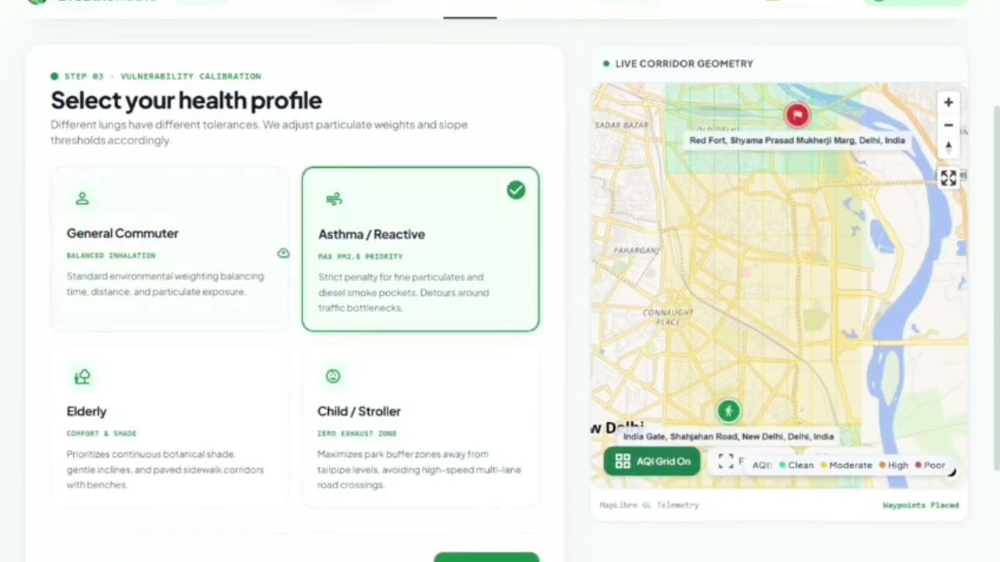
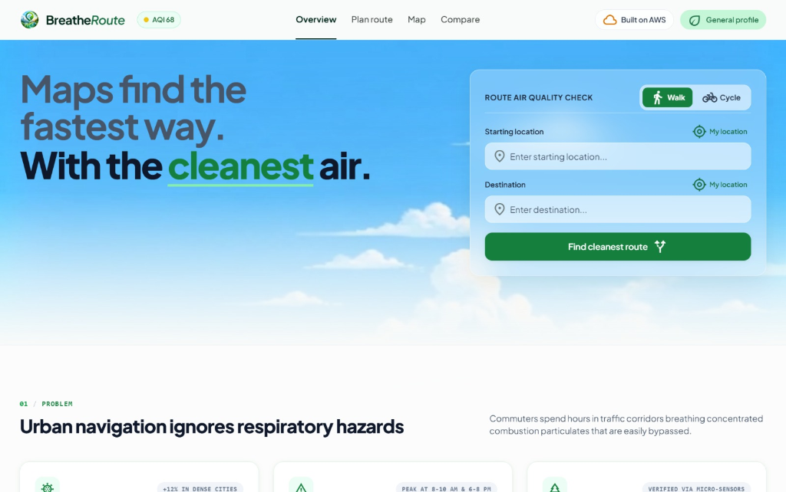
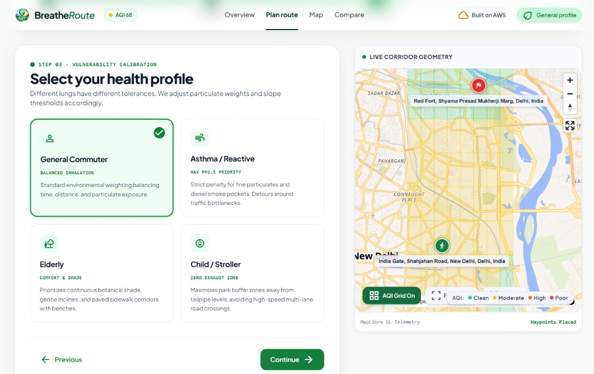
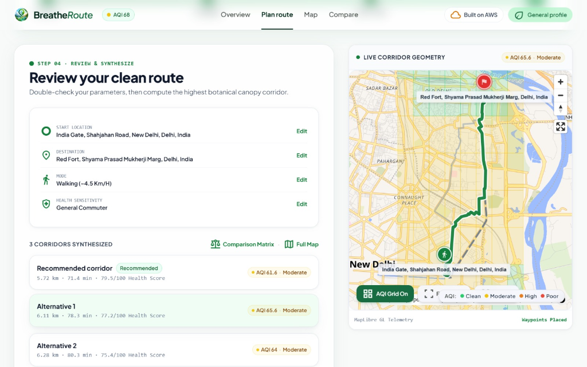
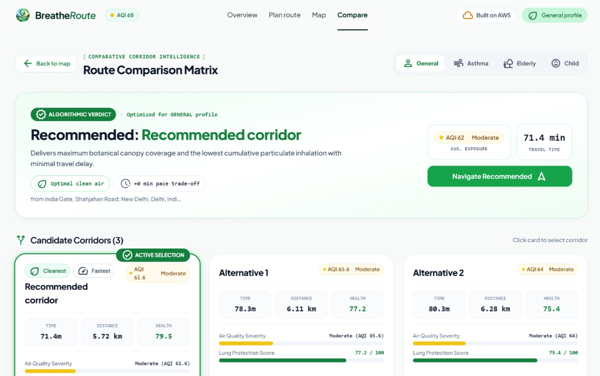
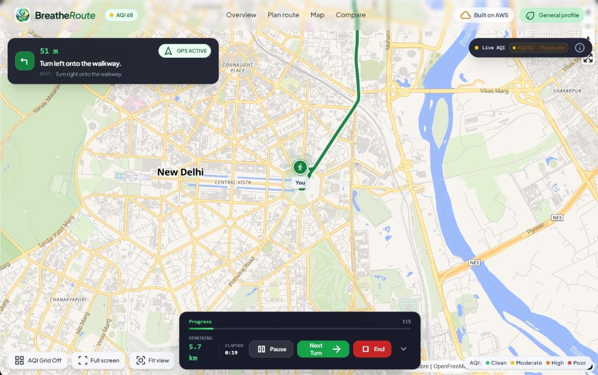

# 🌿 BreatheRoute

> **Atmospheric Precision Clean Navigation**  
> **AWS Environmental Hacks — Air Track**  
> **AWS Region:** `us-east-1`  
> **Live Demo:** [http://100.55.15.141](http://100.55.15.141)  
> **Video Demonstration:** [https://youtu.be/_iXv7dyJZEI](https://youtu.be/_iXv7dyJZEI)

[](https://aws.amazon.com)
[](https://react.dev)
[](https://maplibre.org)
[](https://ai.google.dev)
[](https://terraform.io)

**BreatheRoute** calculates and navigates the **healthiest walking and cycling routes**—not just the fastest—by dynamically scoring candidate corridors against real-time Air Quality Index (AQI), traffic density, and travel time. Route recommendations are calibrated for vulnerable demographic profiles (**General Commuter**, **Asthma / Reactive**, **Elderly**, and **Child / Stroller**), powered by live vector cartography, AWS cloud services, and Google Gemini generative AI clinical guidance.

---

## 📺 Video Walkthrough & Live Demo

Watch the comprehensive video demonstration of BreatheRoute showcasing live route synthesis, vulnerability calibration, multi-corridor comparison matrix, and real-time turn-by-turn navigation through Delhi's air quality grid.

<p align="center">
  <a href="https://youtu.be/_iXv7dyJZEI" target="_blank" rel="noopener noreferrer">
    
  </a>
  <br />
  <strong>▶️ <a href="https://youtu.be/_iXv7dyJZEI" target="_blank" rel="noopener noreferrer">Click here or on the image above to play the video on YouTube</a></strong>
</p>

### What is covered in the video:
1. **The Core Dilemma**: Why conventional turn-by-turn navigation leads pedestrians and cyclists into hazardous pollution choke points.
2. **Multi-Criteria Scoring Engine**: How time, traffic, and particulate exposure (PM2.5 / PM10) are balanced to find cleaner alternative paths.
3. **Profile-Specific Calibration**: Live demonstration of tailoring route recommendations for general commuters vs. asthma patients and strollers.
4. **Interactive Delhi AQI Grid**: Exploring the 625-cell spatial air quality telemetry mesh on vector maps.
5. **Turn-by-Turn GPS Navigation**: Real-time HUD telemetry, step-by-step turn guidance, and active exposure tracking during transit.

---

## 📸 Interactive Application Walkthrough

Explore BreatheRoute's user interface and feature suite captured directly from the live application:

### 1. Clean-Air Route Finder & Atmospheric Headline
The landing interface welcomes commuters with ambient air quality indicators (current Delhi AQI), quick mode toggles for **Walking** or **Cycling**, and instant geocoded address lookups powered by Photon.

<p align="center">
  
</p>

* **Ambient Telemetry**: Live header AQI meter keeps users informed of current outdoor safety levels before departure.
* **Multimodal Switching**: Dedicated pedestrian and cyclist routing profiles calculate speeds, slope preferences, and street suitability.
* **Instant Place Autocomplete**: Search any neighborhood or landmark with sub-second response times.

---

### 2. Vulnerability Calibration & Health Profiles (Step 03)
Not all lungs possess the same tolerance to airborne toxins. BreatheRoute calibrates particulate weighting and detour tolerance across four purpose-built health profiles.

<p align="center">
  
</p>

* **General Commuter**: Balanced inhalation weighting optimizing for a healthy trade-off between transit duration and particulate exposure.
* **Asthma / Reactive**: Aggressive penalty for PM2.5 and diesel exhaust zones; automatically routes around congested traffic choke points.
* **Elderly**: Prioritizes tree-canopy shade, gentle terrain inclines, and continuous pedestrian sidewalks with resting benches.
* **Child / Stroller**: Zero-exhaust micro-corridors; selects park pathways set back from tailpipe height and minimizes multi-lane road crossings.

---

### 3. Route Synthesis & Corridor Review (Step 04)
After specifying endpoints and vulnerability criteria, the routing engine synthesizes multiple candidate corridors via Valhalla and previews the corridor geometry against live air quality cells.

<p align="center">
  
</p>

* **Geometry Verification**: Direct visual verification of departure (e.g. *India Gate*) and destination (e.g. *Red Fort*) waypoints.
* **Multi-Candidate Synthesis**: Computes three distinct path options with estimated distances, durations, and average AQI scores.
* **Interactive Telemetry Map**: MapLibre GL vector canvas dynamically renders route polylines and color-coded AQI grid cells.

---

### 4. Route Comparison Matrix & Health Intelligence
The **Comparative Corridor Intelligence** matrix delivers an algorithmic verdict, ranking candidates with clinical transparency.

<p align="center">
  
</p>

* **Algorithmic Verdict**: Highlights the optimal corridor delivering maximum botanical canopy coverage and minimum cumulative particulate inhalation.
* **Trade-off Insights**: Clear metrics showing pace trade-offs (e.g., *+0 min pace trade-off, optimal clean air*).
* **Lung Protection Score**: Quantitative scores out of 100 benchmarked against air quality severity bars across all candidate routes.

---

### 5. Live Turn-by-Turn GPS Navigation & Environmental HUD
Once underway, the active navigation interface delivers precise navigational prompts combined with live atmospheric telemetry.

<p align="center">
  
</p>

* **Real-Time Turn Guidance**: Direction banner with distance countdowns (e.g., *"51 m — Turn left onto the walkway"*) and upcoming maneuvers.
* **Live Environmental Telemetry**: Real-time ambient AQI badge updates continuously based on the user's current coordinates.
* **Navigation Control Bar**: Real-time progress percentage, remaining kilometers, elapsed transit timer, step pause/advance controls, and toggleable AQI heat grids.

---

## 1. Problem Statement

Standard navigation engines (Google Maps, Apple Maps, Waze) optimize exclusively for travel time or distance. Consequently, they frequently steer pedestrians and cyclists along dense vehicular arteries, traffic choke points, and high-emission freight corridors.

For vulnerable demographics—including children, seniors, and individuals suffering from asthma or cardiovascular conditions—daily exposure to elevated PM2.5 and PM10 causes compounding respiratory damage. Even a minor detour through residential or park corridors can reduce inhaled particulate matter by **30% to 50%**.

---

## 2. Algorithmic Solution

BreatheRoute computes candidate routes and applies multi-criteria Pareto evaluation:

$$\text{Composite Score} = (w_{\text{aqi}} \cdot \text{AQI}) + (w_{\text{traffic}} \cdot \text{Traffic}) + (w_{\text{time}} \cdot \text{Time})$$

* **Dynamic Weighting Vector**: $w_{\text{aqi}}$ increases substantially when the user selects **Asthma / Reactive** or **Child / Stroller** modes.
* **Spatial Delhi AQI Grid**: Integrates 625 geographic cells covering Delhi-NCR stored in DynamoDB table `breatheroute-aqi`.
* **Aegis AI Route Advisory Engine**: Google Gemini (`gemini-3.5-flash` / `gemini-3.5-flash-lite`) interprets composite route exposure metrics and produces physician-grade health advice tailored to the commuter's medical profile.
* **GPU-Accelerated MapLibre GL**: Vector cartography powered by OpenFreeMap Liberty styling, zero-latency vector tile rendering, and custom WebGL overlay shaders.

---

## 3. System Architecture

BreatheRoute is deployed on AWS EC2 orchestrated via Terraform, communicating with serverless cloud infrastructure and generative AI endpoints.

```text
                                  +-----------------------+
                                  |  Amazon EventBridge   |
                                  |   (Hourly Refresh)    |
                                  +-----------+-----------+
                                              |
                                              v
+------------------+             +--------------------------+             +----------------------+
|     Browser      |  HTTP :80   |     AWS EC2 Instance     |  DynamoDB   | Amazon DynamoDB      |
|    (React SPA)   | ----------> |  - Nginx Reverse Proxy   | <---------> |   (breatheroute-aqi) |
|   MapLibre GL    |             |  - Node.js (systemd)     |    Sync     |   625 Delhi Cells    |
+------------------+             +-------------+------------+             +----------------------+
                                               |
                                               v
                                 +--------------------------+             +----------------------+
                                 |  AWS Systems Manager     |             |    Google Gemini     |
                                 |  (SSM Parameter Store)   |             |   Generative AI      |
                                 |  /breatheroute/gemini_*  |             | (gemini-3.5-flash)   |
                                 +--------------------------+             +----------------------+
```

### Infrastructure & Telemetry Workflow
1. **Frontend Ingress**: Nginx serves the compiled React + Vite SPA, manages `.mjs` module MIME headers for MapLibre worker threads, and proxies `/api` requests to the local backend.
2. **Backend Engine**: A high-performance Node.js service running on port 3001 computes Valhalla multi-corridor paths, performs 2D spatial point-in-polygon AQI interpolation, and orchestrates AI advisory generation.
3. **Delhi AQI Spatial Grid**: Evaluates monitored data cached across 625 geographic cells in DynamoDB.
4. **Secure Key Management**: Google Gemini credentials are stored as a `SecureString` in AWS Systems Manager (SSM) Parameter Store, queried at runtime via an IAM instance profile with zero secrets stored in code or repositories.

---

## 4. AWS Services Used

| AWS Service | Architectural Role |
| :--- | :--- |
| **Amazon EC2 (`t3.micro`)** | Compute host running Ubuntu 24.04 LTS, Nginx reverse proxy, and Node.js backend under systemd supervision. |
| **AWS Systems Manager (SSM)** | Parameter Store securely isolates AI API keys as encrypted `SecureString` values. |
| **AWS IAM** | Custom instance role (`breatheroute_app_policy`) enforcing least-privilege access for EC2 to read SSM parameters and DynamoDB. |
| **Amazon DynamoDB** | Fast NoSQL storage housing the 625-cell Delhi air quality spatial mesh (`breatheroute-aqi`). |
| **Amazon API Gateway** | Managed HTTP API (`cyprd9viih`) providing serverless read access to the monitored AQI grid. |
| **Amazon EventBridge** | Automated cron scheduler triggering hourly AQI synchronization jobs. |
| **Terraform (IaC)** | Infrastructure-as-code specifying VPC security groups, IAM policies, and cloud-init auto-provisioning. |
| **OpenFreeMap / Valhalla / Photon** | Open-source vector tiles, multimodal routing engine, and geocoding services. |

---

## 5. Repository Structure

```text
BreatheRoute/
├── frontend/                 # React + Vite web application
│   ├── src/                  # Components, map layers, navigation HUD, and health wizards
│   └── public/               # Cartography assets, icons, and vector markers
├── backend/                  # Node.js API server
│   ├── aegisAi.mjs           # Google Gemini generative AI clinical advisory engine
│   ├── server.mjs            # Spatial routing, AQI point interpolation, and REST endpoints
│   └── routes.mjs            # Valhalla routing integration and candidate synthesis
├── docs/                     # Documentation and multimedia assets
│   ├── images/               # High-resolution screenshots and video thumbnail
│   ├── video-slides/         # Presentation deck HTML for video demonstrations
│   └── WRITEUP.md            # Hackathon project submission writeup
├── terraform/                # Infrastructure as Code
│   ├── main.tf               # EC2, IAM, Security Groups configuration
│   └── user_data.sh.tftpl    # Cloud-init automated server bootstrapping script
├── route-engine/             # Serverless route scoring Lambda functions
└── aqi-traffic/              # AQI spatial mesh ingestion and traffic simulation Lambdas
```

---

## 6. How to Run Locally

### Prerequisites
- Node.js 20+ LTS
- npm 10+

### Step 1: Start the Backend Service

```bash
cd backend
npm install
cp env.example .env     # Optional: configure Gemini API key; fallback advisory operates automatically
npm run dev
```
*Backend runs on `http://localhost:3001`.*

### Step 2: Start the Frontend Application

In a separate terminal:

```bash
cd frontend
npm install
```

Create or verify `frontend/.env.local`:
```env
VITE_API_URL=http://localhost:3001/api
VITE_MAP_STYLE_URL=https://tiles.openfreemap.org/styles/liberty
```

Run the development server:
```bash
npm run dev
```
*Frontend runs on `http://localhost:5173`.*

---

## 7. Cloud Deployment via Terraform

Deploying BreatheRoute to AWS in `us-east-1`:

```bash
cd terraform
terraform init
terraform plan
terraform apply
```

The automated cloud-init bootstrap script configures:
- Node.js 22 LTS & Nginx reverse proxy
- Systemd service daemon for persistent backend operation
- Git repository synchronization and production Vite build
- Automated swap partition creation for `t3.micro` memory optimization

---

## 8. AI Tools & Generative Technology

* **Antigravity (Google DeepMind)**: Full-stack agentic pair programming, cloud infrastructure automation, and automated validation.
* **Google Gemini API (`gemini-3.5-flash` / `gemini-3.5-flash-lite`)**: Real-time natural language synthesis of respiratory risks, comparative corridor evaluations, and health profile advice based on spatial particulate metrics.

---

## 9. Team

| Team Member | Role & Contributions |
| :--- | :--- |
| **Naveenkumar** | Frontend Architecture, Cartographic UI/UX & MapLibre GL Integration |
| **Puvitha** | Backend Services, Spatial Algorithms & Technical Documentation |
| **Swetha** | Data Engineering, DynamoDB AQI Spatial Grid & Traffic Telemetry |
| **Ritheesh** | Route Engine, Cloud Setup, Gemini AI Integration, Video Demonstration & Submission |

---

*Built with passion for the **AWS Environmental Hacks — Air Track**.*
